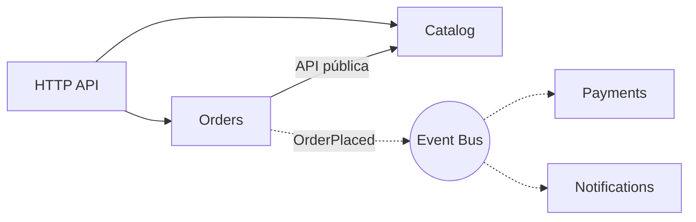

# Fase 09 — Modular Monolith

← [[Fase 08 - Frameworks e Ecossistema]] | [[00 - HOME|Home]] | [[Fase 10 - Microservices]] →

> [!abstract] Objectivo
> Um **único deployable** com módulos de fronteiras fortes — o passo certo antes (ou em vez) de microservices.

## M9.1 — Conceitos
- [ ] Monolito modular vs "big ball of mud" vs microservices
- [ ] Módulo ≈ **bounded context** (DDD estratégico)
- [ ] Quando é a melhor escolha (equipa pequena, domínio ainda a mudar)
- [ ] Custos: disciplina de fronteiras, BD partilhada, deploy conjunto

## M9.2 — Fronteiras em Go
- [ ] Cada módulo em `internal/<modulo>/` com `domain/`, `app/`, `adapter/`
- [ ] **API pública do módulo** = um pacote/facade pequeno (ex.: `internal/orders/api`)
- [ ] O resto do módulo fica inacessível a outros (`internal/` aninhado)
- [ ] Proibir imports entre internals de módulos (`depguard`/`arch-go`)
- [ ] Shared kernel **mínimo** (tipos `Money`, `ID`, erros base)
- Ligação: ISP + DIP em escala de módulo → [[SOLID em Go]]

## M9.3 — Dados
- [ ] **Schema por módulo** (ou prefixo de tabelas) — **nunca** `JOIN` entre módulos
- [ ] Migrações por módulo
- [ ] Referências entre módulos só por **ID**
- [ ] Consistência: transacção local vs eventos

## M9.4 — Comunicação entre módulos
- [ ] **Síncrona**: chamada à API pública (interface)
- [ ] **Assíncrona**: event bus **in-process**
- [ ] **Outbox pattern** (evento e dado gravados na mesma transacção)
- [ ] Idempotência dos handlers
- [ ] Contratos de eventos versionados

## M9.5 — Operação do monolito modular
- [ ] Composition root único registando módulos (`module.Register(...)`)
- [ ] Config e logging por módulo (campo `module` no `slog`)
- [ ] Testes por módulo isolados + testes de contrato entre módulos
- [ ] Opcional: `go.work` com vários `go.mod`

## M9.6 — Caminho para extracção
- [ ] Critérios para extrair (escala independente, equipa própria, ciclo de release)
- [ ] **Strangler pattern**
- [ ] Trocar chamada in-process por cliente HTTP/gRPC **sem mudar o chamador** (graças ao port)

## Aulas
- [ ] M9.1 — `colar-link` · *pesquisa: "modular monolith Golang"*
- [ ] M9.2 — `colar-link`
- [ ] M9.3 / M9.4 — `colar-link` · *pesquisa: "transactional outbox pattern"*
- [ ] M9.6 — `colar-link` · *pesquisa: "monolith to microservices strangler"*

## Exercícios
- [ ] **EX9.1** — Desenhar o mapa de módulos e dependências (Excalidraw/mermaid) para uma loja online
- [ ] **EX9.2** — Implementar `catalog`, `orders`, `payments`, `notifications` com APIs públicas mínimas
- [ ] **EX9.3** — Event bus in-process (`OrderPlaced` → `payments`, `notifications`)
- [ ] **EX9.4** — **Outbox**: gravar evento na mesma transacção + *relay* que publica
- [ ] **EX9.5** — Regra `depguard` a falhar ao importar internals de outro módulo
- [ ] **EX9.6** — Extrair `notifications` para processo separado, mantendo o contrato
- [ ] ** Mini-projecto:** **Mini E-commerce modular** com Postgres, schemas separados e CI a verificar fronteiras

## Erros comuns
- Módulos que partilham tabelas e se "falam" por SQL
- `shared/` a crescer até virar o monolito antigo
- Eventos sem versão nem idempotência
- Extrair serviços cedo demais "porque microservices"

## Dicas
> [!tip] Desenha para poder extrair, não para extrair
> Se um módulo só fala com os outros via interface + eventos, extrair custa dias, não meses.

> [!tip] Referências
> Ver *Wild Workouts* em [[Repositórios de Referência]] para um exemplo prático de Go + DDD.

## Critério de conclusão
- [ ] Linter impede violação de fronteiras
- [ ] Extraí 1 módulo sem alterar o código dos outros
- [ ] Outbox demonstrado com falha simulada entre commit e publicação
