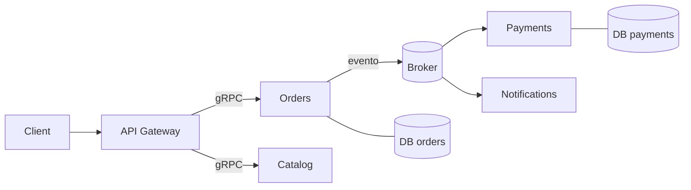

# Fase 10 — Microservices

← [[Fase 09 - Modular Monolith]] | [[00 - HOME|Home]] | [[Fase 11 - Mensageria e Event-Driven]] →

> [!abstract] Objectivo
> Desenhar, comunicar, observar e operar vários serviços Go — sabendo **quando não** os usar.

## M10.1 — Decisão e desenho
- [ ] Quando usar (e quando não): escala, equipas, isolamento de falhas
- [ ] Fronteiras por bounded context; **cada serviço é dono dos seus dados**
- [ ] Custos: rede, consistência eventual, observabilidade, operações
- [ ] Contract-first: APIs e eventos versionados

## M10.2 — Comunicação síncrona
- [ ] REST entre serviços (clientes tipados, timeouts, retries)
- [ ] **gRPC + Protobuf**: `.proto`, `buf`, geração de código
- [ ] Unary vs streaming, interceptors (auth, logging, tracing)
- [ ] `grpc-gateway` ou **Connect** (HTTP/JSON + gRPC)
- [ ] API Gateway / BFF (Traefik, Kong, Envoy — noção)

## M10.3 — Resiliência
- [ ] Timeouts e `context` em **todas** as chamadas
- [ ] Retry com backoff + jitter (só em operações idempotentes)
- [ ] **Circuit breaker** (`sony/gobreaker`), bulkhead
- [ ] Idempotência (`Idempotency-Key`) e deduplicação
- [ ] Degradação graciosa / fallbacks

## M10.4 — Dados distribuídos
- [ ] Sem transacções distribuídas (2PC) — porquê
- [ ] **Saga**: coreografia vs orquestração
- [ ] **Outbox/Inbox** (ligação com [[Fase 09 - Modular Monolith]])
- [ ] CQRS e event sourcing — noção e quando evitar
- [ ] Consistência eventual na UX

## M10.5 — Contentores e orquestração
- [ ] Dockerfile **multi-stage** (imagem final `distroless`/`scratch`)
- [ ] `docker-compose` para stack local completa
- [ ] **Kubernetes** básico: Deployment, Service, ConfigMap/Secret, probes, HPA
- [ ] Helm / Kustomize (noção)
- [ ] Service discovery e config externalizada

## M10.6 — Toolkits e workflows
- [ ] **go-kit**, **Kratos** — noção do que oferecem
- [ ] **Temporal** (workflows duráveis) — noção
- [ ] Testes de contrato (Pact — noção) e testes E2E mínimos

## Aulas
- [ ] M10.1 — `colar-link` · *pesquisa: "microservices when not to use"*
- [ ] M10.2 — `colar-link` · *pesquisa: "gRPC Go tutorial", "buf protobuf Go"*
- [ ] M10.3 — `colar-link` · *pesquisa: "circuit breaker Go gobreaker"*
- [ ] M10.4 — `colar-link` · *pesquisa: "saga pattern microservices Go"*
- [ ] M10.5 — `colar-link` · *pesquisa: "Go Dockerfile multi-stage", "Kubernetes for developers"*

## Exercícios
- [ ] **EX10.1** — Dois serviços (`orders`, `inventory`) a falar por **gRPC**
- [ ] **EX10.2** — Gateway simples que expõe REST e chama gRPC
- [ ] **EX10.3** — Circuit breaker + timeout + retry no cliente; simular falhas
- [ ] **EX10.4** — **Saga** de pedido (reservar stock → cobrar → confirmar, com compensação)
- [ ] **EX10.5** — Dockerfile multi-stage < 30 MB; `docker-compose` com tudo
- [ ] **EX10.6** — Deploy local em Kubernetes (kind/minikube) com probes e HPA
- [ ] ** Mini-projecto:** Extrair 2–3 módulos do mini e-commerce para serviços independentes

## Erros comuns
- **Monolito distribuído**: serviços acoplados que têm de ser deployados juntos
- BD partilhada entre serviços
- Retries cegos em operações não idempotentes → duplicados
- Sem timeouts → falhas em cascata
- Microservices antes de ter observabilidade (Fase 12)

## Dicas
> [!tip] Cada serviço é uma Clean Architecture pequena
> O que aprendeste na [[Fase 07 - Clean Architecture e SOLID]] repete-se por serviço; o `transport` muda (gRPC/HTTP/consumer), o domínio não.

> [!tip] Proto é contrato
> Nunca reutilizes números de campo; usa `reserved`. Versiona pacotes (`v1`, `v2`).

## Critério de conclusão
- [ ] Sistema sobe com um comando (`docker compose up`)
- [ ] Falha de um serviço não derruba os outros (demonstrado)
- [ ] Saga com compensação testada
