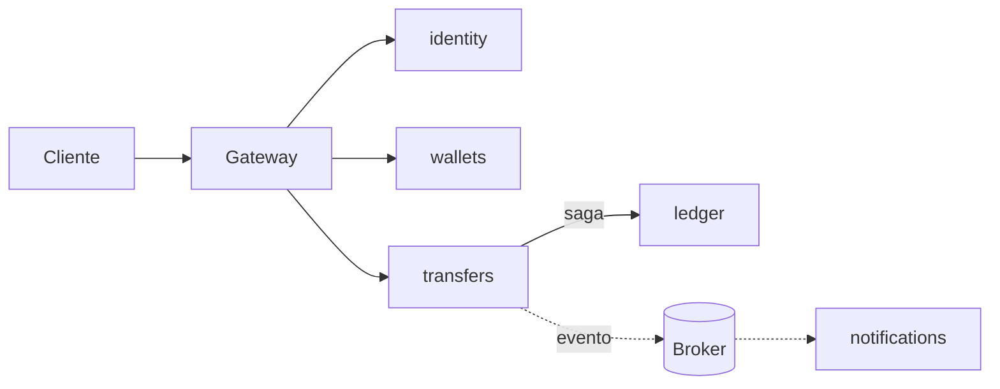

# Fase 14 — Capstone

← [[Fase 13 - Performance e Avançado]] | [[00 - HOME|Home]]

> [!abstract] Objectivo
> Consolidar tudo num projecto de portefólio: **começa como modular monolith e evolui para microservices**, com a arquitectura documentada e provada.

## Projecto A — *FinPay Wallet* (modular monolith)
Módulos: `identity` · `wallets` · `ledger` (dupla entrada) · `transfers` · `notifications`

### Requisitos funcionais
- [ ] Registo/login (JWT + refresh) e papéis
- [ ] Criar carteira, depositar, levantar, transferir
- [ ] Ledger **imutável** de dupla entrada (débitos = créditos)
- [ ] Extracto paginado e filtros
- [ ] Notificações assíncronas (email/webhook simulado)
- [ ] Idempotência em operações financeiras (`Idempotency-Key`)

### Requisitos técnicos
- [ ] Clean Architecture por módulo ([[Fase 07 - Clean Architecture e SOLID]])
- [ ] Fronteiras impostas por linter ([[Fase 09 - Modular Monolith]])
- [ ] Postgres com schema por módulo; migrações; sqlc/pgx
- [ ] Outbox + event bus in-process
- [ ] OpenAPI; erros em formato único
- [ ] Testes: unit (fakes), integração (testcontainers), `-race`, fuzz num parser
- [ ] CI completo (lint, test, vuln, build, docker)
- [ ] Observabilidade: slog JSON, Prometheus, OTel

### Definition of Done — A
- [ ] README com diagrama C4 (contexto + contentores) em mermaid
- [ ] ≥ 3 ADRs ([[Template - ADR]])
- [ ] `docker compose up` sobe tudo; seed de dados
- [ ] Teste de carga + relatório de pprof

## Projecto B — Evolução para microservices
- [ ] Extrair `notifications` e `transfers`/`ledger` para serviços independentes
- [ ] Contratos gRPC com `buf` (breaking-change check no CI)
- [ ] Broker (NATS/Kafka/RabbitMQ) para eventos; **Saga** de transferência
- [ ] Circuit breaker, timeouts, retries idempotentes
- [ ] Gateway à frente
- [ ] Deploy em Kubernetes (kind) com probes/HPA **ou** VPS com compose
- [ ] Tracing distribuído atravessando todos os serviços
- [ ] Documento de **trade-offs**: o que melhorou, o que piorou, custo operacional

## Projecto C — Contribuição / biblioteca (opcional)
- [ ] Publicar uma lib Go pequena e útil (ex.: LRU genérico, retry, paginação por cursor) com semver, docs e CI
- [ ] Contribuir com 1 PR (docs/bug) num projecto open source Go

## Plano sugerido (6 semanas)
| Semana | Foco |
|---|---|
| 1 | Desenho: eventos, módulos, ADRs, esqueleto + CI |
| 2 | `identity`, `wallets` |
| 3 | `ledger`, `transfers`, outbox |
| 4 | Observabilidade, segurança, carga |
| 5 | Extracção para microservices (gRPC + broker) |
| 6 | Saga, resiliência, deploy, documentação |

## Critério de conclusão do roadmap
- [ ] Projectos A e B no GitHub com README e diagramas
- [ ] Consigo defender cada decisão de arquitectura em 2 minutos
- [ ] Consigo explicar **quando não** usar microservices
