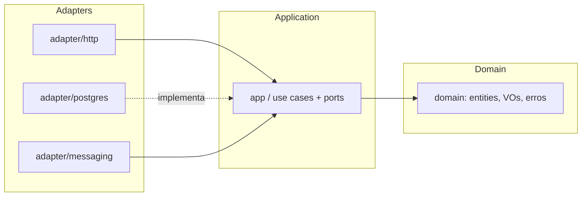

# Clean Architecture em Go

[[00 - HOME|Home]] · [[Fase 07 - Clean Architecture e SOLID]] · [[SOLID em Go]]

## Dependency Rule

> Setas de **código** apontam para dentro. Adapters dependem do `app`; `app` depende do `domain`; **domain não depende de ninguém**.

## Layout por feature (recomendado à medida que cresce)
```text
.
├── cmd/
│   └── api/main.go              # composition root
├── internal/
│   ├── wallet/
│   │   ├── domain/              # Wallet, Money, ErrInsufficientFunds
│   │   ├── app/                 # TransferUseCase + ports (WalletRepo, Clock)
│   │   └── adapter/
│   │       ├── http/            # handlers, DTOs, mapeamento de erros
│   │       ├── postgres/        # repo (sqlc/pgx)
│   │       └── memory/          # repo p/ testes
│   └── platform/                # config, logger, db pool, middleware comum
├── migrations/
├── api/openapi.yaml
└── go.mod
```

## Esqueleto de código
```go
// internal/wallet/domain/wallet.go
package domain

import "errors"

var ErrInsufficientFunds = errors.New("saldo insuficiente")

type Wallet struct {
    id      string
    balance int64 // menor unidade (cêntimos)
}

func (w *Wallet) Debit(amount int64) error {
    if amount <= 0 { return errors.New("valor inválido") }
    if w.balance < amount { return ErrInsufficientFunds }
    w.balance -= amount
    return nil
}
func (w *Wallet) Credit(amount int64) { w.balance += amount }
```
```go
// internal/wallet/app/transfer.go
package app

type WalletRepo interface {
    Get(ctx context.Context, id string) (*domain.Wallet, error)
    Save(ctx context.Context, w *domain.Wallet) error
}
type TxRunner interface {
    WithTx(ctx context.Context, fn func(ctx context.Context) error) error
}

type TransferInput struct{ From, To string; Amount int64 }

type Transfer struct {
    repo WalletRepo
    tx   TxRunner
}
func NewTransfer(r WalletRepo, tx TxRunner) *Transfer { return &Transfer{r, tx} }

func (uc *Transfer) Execute(ctx context.Context, in TransferInput) error {
    return uc.tx.WithTx(ctx, func(ctx context.Context) error {
        from, err := uc.repo.Get(ctx, in.From); if err != nil { return err }
        to, err := uc.repo.Get(ctx, in.To);     if err != nil { return err }
        if err := from.Debit(in.Amount); err != nil { return err }
        to.Credit(in.Amount)
        if err := uc.repo.Save(ctx, from); err != nil { return err }
        return uc.repo.Save(ctx, to)
    })
}
```
```go
// internal/wallet/adapter/http/errors.go — domínio → HTTP
func statusFor(err error) int {
    switch {
    case errors.Is(err, domain.ErrInsufficientFunds): return http.StatusUnprocessableEntity
    case errors.Is(err, app.ErrNotFound):             return http.StatusNotFound
    default:                                          return http.StatusInternalServerError
    }
}
```

## Checklist
- [ ] `domain` não importa `net/http`, `database/sql`, ORM nem framework
- [ ] Use cases testados com fakes (sem BD, sem HTTP)
- [ ] DTO de transporte ≠ entidade de domínio ≠ modelo de BD
- [ ] Transacção definida na camada `app`
- [ ] Erros de domínio mapeados num único sítio
- [ ] `depguard`/`arch-go` a impor a regra no CI

## Versão modular monolith
```text
internal/
├── catalog/   { domain, app, adapter, api/ }   # api/ = fachada pública
├── orders/    { domain, app, adapter, api/ }
└── payments/  { domain, app, adapter, api/ }
# Regra: orders só importa catalog/api — nunca catalog/domain|app|adapter
```
